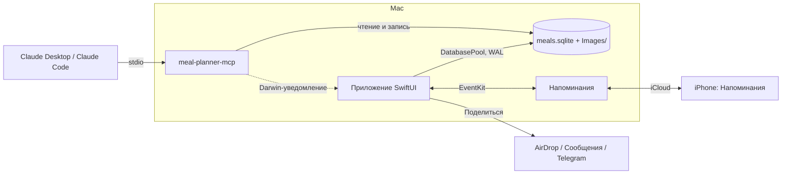

# План разработки: Meal Planner & Recipes — рецепты, запасы, покупки и меню на неделю (macOS)

Версия 1.1 · 23 октября 2026

---

## 1. Цель и рамки

**Цель.** Заменить связку баз в Notion (Recipes, Ingredients, Meal planner) приложением для Mac с тёмным интерфейсом, где рецепт, продукты дома, список покупок и меню на неделю связаны между собой. Открыл рецепт — видно, чего не хватает. Составил меню на неделю — получил список покупок. Купил — запасы обновились. Рецепты и меню можно заполнять руками или через Claude: по MCP, в рамках подписки. Список покупок попадает на iPhone без своего сервера и без приложения в App Store.

**Входит в MVP**
- Категории рецептов: создать, переименовать, сменить цвет и порядок, удалить.
- Рецепты: фото или видео (YouTube, Rutube, VK Видео, любой iframe), КБЖУ на 100 г и на порцию, ссылка на источник, ингредиенты с количеством, шаги приготовления, пересчёт на нужное число порций.
- Наличие ингредиентов («есть», «мало», «нет») и кнопка «в покупки» для одного или для всех недостающих.
- База продуктов с КБЖУ и начальным набором около 300 продуктов. Новый ингредиент в рецепте сразу становится продуктом в базе.
- Запасы дома: что есть и сколько.
- Список покупок: что купить, сколько и для каких блюд. Отметка «куплено» добавляет продукт в запасы.
- Меню на неделю: сетка «дни × приёмы пищи» (завтрак, обед, ужин, перекус), перетаскивание карточек, КБЖУ за день, список покупок на неделю.
- MCP-сервер: рецепты, продукты, запасы, покупки и меню доступны в Claude Desktop и Claude Code.
- Список покупок на iPhone через «Напоминания», в обе стороны.
- «Поделиться» рецептом: картинка-карточка и текст через системное меню.
- Поиск, фильтры и сортировка во всех таблицах и списках; длинные списки подгружаются сами по мере прокрутки.

**Сознательно не входит в MVP**
- Приложение для iPhone и свой сервер. Если когда-нибудь понадобится полноценный клиент — см. §8, вариант 5.
- Дневник питания и дневные цели по калориям.
- Сроки годности и места хранения (холодильник, морозилка, шкаф).
- Светлая тема. Цвета сразу задаём токенами, так что добавить её потом недорого.
- Разбор видео (расшифровка речи). Рецепт по видео Claude заполняет по описанию и вашим подсказкам.

---

## 2. Ключевые решения

| Вопрос | Решение | Почему |
|---|---|---|
| Технологии | Swift 6 + SwiftUI на каркасе Market Monitor: XcodeGen, Makefile, Swift-пакет с модулями, GRDB, MCP swift-sdk, Swift Testing | Каркас обкатан, и Claude Code с ним уже работал. Нативно доступны «Напоминания» (EventKit), системное «Поделиться», рендер карточек (`ImageRenderer`), превью ссылок (LinkPresentation) и WKWebView для видео. Tauri или Electron дали бы веб-стек, но EventKit и «Поделиться» всё равно пришлось бы писать нативными мостами |
| Минимальная macOS | 26.0 | Как у Market Monitor: свежий SwiftUI без оглядки на старые версии |
| Тема | Тёмная по умолчанию, палитра как в Notion на скриншотах; все цвета — токены | Светлая тема потом — это одна таблица значений |
| Хранение | SQLite (GRDB, WAL) и папка с фото | Одну базу читают и пишут приложение и MCP-сервер, в том числе когда приложение закрыто |
| Списки | Поиск, фильтры и сортировка выполняются в SQLite на всех экранах; виртуальные списки с автоматической подгрузкой блоками по 100 строк, без номеров страниц | Одинаково быстро при любом объёме базы; те же запросы использует MCP-сервер (§6) |
| Количества | У продукта есть базовая единица (г, мл или шт) и пересчёты: вес 1 шт, вес 1 ст. л., плотность | Без этого не сравнить «3 ст. л. молока» в рецепте с «0,5 л» дома |
| Начальная база продуктов | Около 300 продуктов на русском. КБЖУ — по USDA FoodData Central (общественное достояние); для русских продуктов (творог, кефир, ряженка, гречка…) — по типичным значениям с упаковок | Лицензионно чисто; у каждого значения указан источник, и его проверяет тест |
| Claude | Только подписка Max, без API-ключа. A) MCP-сервер внутри приложения и кнопки «Открыть в Claude». B) `claude -p` для действий в один клик | См. §7 |
| Покупки на iPhone | Общий семейный список в «Напоминаниях» через EventKit, синхронизация в обе стороны | iCloud синхронизирует сам; у каждого в семье — штатное приложение; что добавили или отметили родные, попадает в приложение |
| Рецепт на телефон | Системное «Поделиться»: карточка-картинка под экран телефона и текст | AirDrop, Сообщения, Telegram, Заметки — без настройки |
| Название | «Meal Planner & Recipes» — в Dock, меню и заголовке окна. Цели сборки и бандл — `MealPlanner` | Как папка проекта. Без «&» и пробелов в путях сборки проще Makefile и скрипты |
| Идентификаторы | Команда `6S43T3N4UL`; `inco.mealplanner.app` (у Debug — `.debug`), `inco.mealplanner.mcp`; данные — в `~/Library/Application Support/inco.mealplanner/` | По образцу Market Monitor |

---

## 3. Архитектура

**Компоненты**
1. **`MealCore`** (Swift Package, только Foundation). Модели, единицы и пересчёты, расчёт КБЖУ, наличие, сборка списка покупок, распределение запасов по меню недели, разбор строк вида «40 г феты», типы запросов для списков (поиск, фильтры, сортировка). Всё покрыто тестами.
2. **`MealStore`** → `MealCore`, GRDB. Схема, миграции, репозитории, перевод запросов списков в SQL, полнотекстовый поиск (FTS5), кеш вычисляемых значений для сортировки, начальная база продуктов, резервные копии, уведомления об изменениях между процессами. Здесь же правила валидации, чтобы приложение и Claude проходили через одни и те же проверки.
3. **`MealMCP`** → `MealCore`, `MealStore`, MCP SDK. Инструменты и промпты для Claude.
4. **`MealReminders`** → `MealCore`, EventKit. Синхронизация списка покупок с «Напоминаниями»; логика сопоставления тестируется на поддельном хранилище.
5. **Приложение (SwiftUI).** Окна, экраны, карточка для «Поделиться», связь с macOS. Логики здесь нет — она в пакете.
6. **`meal-planner-mcp`.** Исполняемый файл в `MealPlanner.app/Contents/Helpers/`; Claude Desktop запускает его по stdio. Обновили приложение — обновился и сервер.



**Запись из двух процессов.** Приложение и MCP-сервер пишут в одну базу (WAL, `busyTimeout`). `ValueObservation` в GRDB не видит записей другого процесса. Поэтому после каждой записи MCP-сервер отправляет Darwin-уведомление `inco.mealplanner.changed`, а приложение вызывает `db.notifyChanges(in: .fullDatabase)`, и экраны обновляются сами. На случай пропущенного уведомления при активации окна приложение сверяет `PRAGMA data_version`.

**Фото** хранятся файлами в `Images/<uuid>.jpg`, уменьшенными до 1600 px по длинной стороне; в базе — только имя файла. Для галереи кешируются миниатюры.

---

## 4. Данные

### 4.1 Таблицы

| Таблица | Ключевые поля | Заметки |
|---|---|---|
| `category` | name, color, emoji, position | Удаление категории не удаляет рецепты |
| `recipe` | title, photo, videoURL, sourceURL, servings (по умолчанию 2), yieldGrams, prepMinutes, cookMinutes, notes, nutritionOverride, favorite, deletedAt, даты | КБЖУ считается из ингредиентов; ручное значение (например, с сайта) перекрывает расчёт. Удалённое 30 дней лежит в корзине |
| `recipe_category` | recipeId, categoryId | Рецепт бывает в нескольких категориях: «Омлет» — и «Завтраки», и «Быстрые» |
| `recipe_meal_type` | recipeId, mealType | «Подходит для» — фильтр в библиотеке планировщика |
| `recipe_ingredient` | recipeId, productId, quantity (пусто — «по вкусу»), unit, note, group («Для соуса»), optional, position | |
| `recipe_step` | recipeId, position, text | |
| `recipe_stats` | recipeId, titleKey, searchText, kcalPer100, kcalPerServing, Б/Ж/У на порцию, totalMinutes, isNutritionComplete | Кеш вычисляемых значений для сортировки, фильтров и поиска (§6.3). Наличие (missingCount) добавится на этапе 4, «давно не готовил» (lastCookedAt) — на этапе 5 |
| `product` | name, nameKey, aliases, aisleId, kcal / protein / fat / carbs на 100 г, baseUnit, gramsPerPiece, density, namedUnits, isStaple, nutritionSource, sourceNote, needsReview, seedKey, searchText | staple — соль, перец, масло: важно, есть или нет, а не сколько граммов. namedUnits — вес единиц, которые знает только сам продукт: «1 зубчик чеснока = 5 г»; хранится в самой строке, отдельная таблица оказалась не нужна |
| `aisle` | name, position | Отделы магазина: «Овощи и зелень», «Молочное и яйца», «Крупы»…; порядок — как вы ходите по магазину |
| `pantry_item` | productId, quantity (в базовой единице; пусто у staple), updatedAt | |
| `shopping_item` | productId или freeText, quantity, unit, reasons (для каких блюд и дней), checked, reminderID, position | |
| `meal_type` | key, name, color, position | Завтрак, обед, ужин, перекус — заведены сразу на этапе 2, чтобы рецепт мог «подходить на» приём пищи; переименование и свои приёмы пищи — на этапе 5 |
| `plan_entry` | date, mealType, recipeId или freeText («ужин в гостях»), servings, position, cookedAt | |

Поиск, фильтры и сортировка по всем таблицам — §6.

### 4.2 Единицы и пересчёты

- Масса: г, кг. Объём: мл, л, ч. л. = 5 мл, ст. л. = 15 мл, стакан = 250 мл. Штуки: шт, зубчик, пучок, ломтик. Без количества: щепотка, по вкусу.
- Внутри одного измерения пересчитываем по таблице. Между измерениями — через свойства продукта: вес 1 шт, плотность, вес именованных единиц.
- Ложки и стакан — ровные метрические меры: ч. л. = 5 мл, ст. л. = 15 мл, стакан = 250 мл. Плотность сыпучих продуктов в начальной базе взята из мер USDA (1 стакан муки = 125 г), поэтому «2 ст. л. муки» — это граммы, а не догадка.
- Если пересчитать нельзя (в рецепте «1 пучок», а вес пучка у продукта не задан), наличие показывается как «?» с подсказкой задать пересчёт. Молча ошибаться нельзя.

### 4.3 КБЖУ

- Всего в рецепте = Σ (граммы ингредиента × КБЖУ на 100 г / 100).
- На 100 г = всего / выход готового блюда. Если выход не задан — делим на сумму сырых весов и помечаем «по сырому весу».
- На порцию = всего / число порций. Сейчас в Notion «Calories per portion» показывает 0 — здесь значение считается всегда.
- Ингредиенты без КБЖУ или без пересчёта в граммы расчёт не ломают. Пишем «посчитано по 5 из 7 ингредиентов», а продукты попадают в список «заполнить КБЖУ» — руками или через Claude.
- Проверка калорий по макронутриентам. У продуктов из USDA — по коэффициентам самой USDA для этого продукта (у какао углеводы дают 1,33 ккал на грамм, у отрубей 2,35), допуск 8 %; у остальных — 4·Б + 9·Ж + 4·У, допуск 15 % или 10 ккал. Тест прогоняет так весь начальный набор; уксусы исключены — их энергия в уксусной кислоте. Редактор продукта подсказывает при расхождении для всего, что введено не из USDA.
- В меню недели считаем всё сразу: на одного человека (по порции каждого блюда) и всего по приготовленным порциям — за каждый день и в среднем за неделю. Какие показатели видны (ккал, Б, Ж, У, на человека, всего), выбирается в меню «Вид»; лишнее скрывается.

### 4.4 Наличие

- **В рецепте** нужное количество (с учётом выбранных порций) сравнивается с запасами. Статусы: **Есть** (зелёный); **Мало** — есть, но не хватает, с цифрой «нужно ещё 20 г» (жёлтый); **Нет** (розовый, как To buy в Notion); **?** — сравнить нельзя. У staple-продуктов — только «есть» или «нет».
- **В меню недели** запасы распределяются по блюдам по порядку, начиная с сегодняшнего. Карточка блюда, на которое уже не хватает, помечается точкой. Список покупок на неделю — это суммарная нехватка.
- «Приготовлено» на карточке меню показывает, что спишется из запасов, и списывает только после подтверждения. В этом окне можно поправить количества (например, сыра ушло меньше). Отменить можно и потом.
- «Куплено» в списке покупок тоже спрашивает: одно окно для всего купленного, количества можно поправить. В Настройках это можно переключить на «пополнять без вопросов».

---

## 5. Интерфейс

**Тёмная тема** — по мотивам текущего Notion. Фон `#191919`, поверхности `#202020` и `#252525`, карточки `#2C2C2C`, линии `#373737`, текст `#E6E6E6`, вторичный текст `#9B9B9B`. Статусы: зелёный «есть» (как In stock), розовый «купить» (как To buy), жёлтый «мало». Приёмы пищи: завтрак — охра (как тег «Завтраки»), обед — зелёный, ужин — синий, перекус — розовый. Все значения — токены в Asset Catalog.

**Окно** — `NavigationSplitView`. В боковой панели: Рецепты, Меню на неделю, Запасы, Покупки, Продукты. Ниже — категории со счётчиком рецептов, они работают как фильтры. Настройки (⌘,): Claude, «Напоминания», порции по умолчанию (2), резервные копии.

На всех экранах со списками есть поиск, фильтры, сортировка и автоматическая подгрузка, устроенные одинаково — см. §6.

**Рецепты: галерея.** Как в Notion: группы по категориям со сворачиваемыми цветными заголовками. Карточки по 4 в ряд (зависит от ширины окна): фото, название, «140 ккал/100 г · порция 280 ккал», значок наличия «Всё есть» или «Не хватает 2». Сверху — поиск, строка фильтров, сортировка и «Новый рецепт». Второй вид — таблица КБЖУ (аналог Nutrition value) с сортировкой по любой колонке.

**Рецепт: страница.** Повторяет скриншот из Notion:
- обложка-фото; если есть видео — кнопка ▶ на обложке включает встроенный плеер;
- заголовок и строка свойств: ккал на 100 г и на порцию, Б/Ж/У, время, категории, порции [− 2 +] — всё ниже пересчитывается;
- блок «Ингредиенты на 2 порции» с колонками «Название», «Кол-во», «Ед.», «Наличие», «В покупки»; над таблицей — «Добавить недостающее в покупки»;
- «Способ приготовления» — нумерованные шаги;
- карточки источника и видео с превью (LinkPresentation, как закладка в Notion);
- меню: «Редактировать» (⌘E), «Поделиться», «Добавить в меню…», «Дублировать», «Удалить».

**Редактор рецепта** — те же блоки в режиме правки.
- Фото: перетащить файл или картинку из Safari, вставить из буфера обмена, указать ссылку.
- Видео: ссылка или код `<iframe>` — из кода берётся `src`.
- Ингредиенты: строка с автодополнением. Набираете «40 г фет…» — подсказки из базы продуктов. Если продукта нет — «Создать продукт „Фета“» прямо в строке; он попадает в базу с пометкой «заполнить КБЖУ».
- Шаги: список, порядок меняется перетаскиванием.
- Кнопка «Заполнить с Claude» — см. §7.

**Меню на неделю**

```
← Неделя 43 · 19–25 октября →   [Сегодня]   [Скопировать прошлую неделю]   [Покупки на неделю]

          ПН 19       ВТ 20       СР 21      …  ВС 25       │ Рецепты
Завтрак   [Омлет  ]   [Чиа-     ]     +                     │ 🔍 Поиск
          [2 порц.]   [пудинг   ]                           │ [Завтрак ▾] [Всё есть]
Обед      …                                                 │ ▢ Омлет с фетой
Ужин      …                                                 │ ▢ Сырники
Перекус   …                                                 │ ▢ Тост с ростбифом
──────────────────────────────────────────────────────────  │ …
Итого     1 850 ккал  Б 95 · Ж 70 · У 210 …                 │
```

- Перетаскивание: из списка рецептов справа в ячейку — добавить; между ячейками — перенести; с ⌥ — скопировать; ⌫ — удалить. Для карточки — свой `UTType`.
- Карточка: миниатюра, название, порции, точка «чего-то не хватает». Меню карточки: открыть рецепт, изменить порции, «Приготовлено», повторить в другие дни, удалить.
- «+» в пустой ячейке открывает быстрый поиск. Можно вписать свободный текст («ужин в гостях»).
- Приёмы пищи — строки: их можно свернуть, переименовать, добавить свой.
- Итоги под каждым днём и за неделю: на человека и всего; лишние показатели скрываются в меню «Вид» (§4.3).

**Запасы.** Список по отделам: продукт и количество со степпером. Быстрая строка «+ яйца 10» разбирается так же, как строка ингредиента. У staple-продуктов — переключатель «есть / закончилось». Фильтр «заканчивается».

**Покупки.** Позиции по отделам магазина: галочка, количество, подпись «для: Омлет, Сырники». Кнопки «Собрать на неделю», «Очистить купленное», «Поделиться текстом» и значок синхронизации с «Напоминаниями».

**Продукты.** Таблица: название, отдел, ккал, Б, Ж, У, базовая единица, вес 1 шт, в скольких рецептах, пометка «проверить»; сортировка по любой колонке. Правка — в инспекторе справа. «Объединить» для дублей: «Яйцо» и «Яйца» становятся одним продуктом, рецепты перепривязываются.

---

## 6. Списки: поиск, фильтры, сортировка и подгрузка

Устроено одинаково на всех экранах со списками: рецепты (галерея и таблица КБЖУ), продукты, запасы, покупки, категории и список рецептов справа в меню недели.

### 6.1 Как выглядит

- **Поиск** — поле в панели инструментов (⌘F). Результаты обновляются по мере ввода с задержкой около 150 мс, совпадения подсвечиваются.
- **Фильтры** — строка «чипов» под панелью инструментов, как в Notion: «+ Фильтр» → поле → условие → значение. У каждого чипа есть крестик, рядом — «Сбросить всё». Число активных фильтров видно на кнопке.
- **Сортировка** — клик по заголовку колонки в таблицах (повторный клик — обратный порядок), в галерее — меню «Сортировка». Можно добавить второй ключ. При равных значениях порядок задают название и id, чтобы строки не прыгали.
- Внизу списка — «Показано 100 из 1 240».
- Поиск, фильтры, сортировка, ширина и видимость колонок запоминаются для каждого экрана.
- Позже, на этапе 7:
  - **сохранённые виды** — вкладки над списком, как Recipes и Nutrition value в Notion, например «Быстрые завтраки до 300 ккал»;
  - **быстрый поиск ⌘K** по всему приложению: рецепты, продукты, запасы, покупки и категории одним списком с разделами, Enter открывает найденное.

### 6.2 Что ищем, фильтруем и сортируем

| Экран | Поиск | Фильтры | Сортировка |
|---|---|---|---|
| Рецепты | название, ингредиенты, шаги, заметки | категории; приём пищи; наличие («всё есть», «не хватает не больше N»); содержит продукт или без него («без молока»); ккал на порцию и Б/Ж/У — от и до; время — до N минут; избранное; есть фото или видео; КБЖУ посчитано не полностью | название; дата добавления и изменения; ккал на 100 г и на порцию; Б, Ж, У; время; наличие; «давно не готовил» |
| Продукты | название, синонимы | отдел; staple; без КБЖУ или «проверить»; используется в рецептах; есть дома; ккал — от и до; источник КБЖУ | название, отдел, ккал, Б, Ж, У, число рецептов, дата добавления |
| Запасы | название продукта | отдел; статус («есть», «мало», «закончилось»); нужен для меню недели | название, отдел, количество, дата обновления |
| Покупки | название | отдел; куплено или нет; для какого блюда или дня; синхронизировано с «Напоминаниями» | порядок отделов в магазине (по умолчанию), название, дата добавления, ручной порядок |
| Категории | название | — | ручной порядок, название, число рецептов |
| Меню недели: рецепты справа | как в «Рецептах» | приём пищи, наличие, категории | как в «Рецептах» |

### 6.3 Как устроено

- Поиск, фильтры и сортировка выполняются в SQLite, а не в памяти. Поэтому они одинаково работают при любом объёме и согласованы с подгрузкой: следующий блок продолжает тот же порядок.
- Для каждого экрана в `MealCore` есть тип запроса — `RecipeQuery`, `ProductQuery`, `PantryQuery`, `ShoppingQuery`: текст, фильтры, сортировка. `MealStore` переводит его в SQL (query interface GRDB и FTS5). Те же типы принимают MCP-инструменты `search_*`, так что Claude ищет и сортирует так же, как интерфейс.
- Полнотекстовый поиск — FTS5 с токенизатором `unicode61`:
  - регистр не важен, в том числе у кириллицы;
  - «ё» заменяем на «е» сами — при записи в индекс и в запросе: встроенное удаление диакритики в FTS5 работает только для латиницы;
  - ищем по началу слова, а окончания отбрасывает стеммер Snowball для русского: «яйцо» превращается в «яйц*» и находит «яйца», «сливочного масла» находит «Масло сливочное»;
  - синонимы продуктов лежат в индексе вместе с названием.
- Вычисляемые значения — КБЖУ рецепта, сколько ингредиентов не хватает, когда блюдо готовили последний раз — хранятся в кеш-таблице `recipe_stats`. `MealStore` пересчитывает её при изменении рецепта, продукта, запасов или меню. Без кеша в SQL не отсортировать по «ккал на порцию» и не отфильтровать «можно приготовить сейчас». Тест сверяет кеш с прямым расчётом.
- Под частые фильтры и сортировки — индексы: отдел и название продукта, категория рецепта, дата и приём пищи в меню.

### 6.4 Подгрузка: виртуальный список вместо страниц

- Номеров страниц нет: на Mac естественнее прокручивать, чем листать, а порядок сортировки не рвётся на границах страниц.
- Таблицы и списки — `Table` и `List`. На macOS они построены на `NSTableView` и создают только видимые строки. Галерея — `LazyVGrid`: карточки создаются по мере прокрутки.
- Данные приходят блоками по 100 строк. GRDB `ValueObservation` следит за запросом с `LIMIT n`; когда до конца загруженного остаётся 20 строк, n увеличивается на 100.
- Если данные изменились (в том числе через Claude), загруженная часть перечитывается сама, а прокрутка остаётся на той же строке: строки опознаются по id.
- Новый поиск, фильтр или сортировка сбрасывают загрузку до первых 100 строк и прокручивают список наверх.
- Миниатюры в галерее грузятся асинхронно и уменьшенными (ImageIO), кешируются в `NSCache`. Загрузка для карточек, ушедших с экрана, отменяется.
- Почему `LIMIT n`, а не выборка по курсору: загруженную часть проще держать актуальной, когда пишет второй процесс, а при наших объёмах перечитать n строк — дело миллисекунд. Курсор (keyset) нужен только MCP: `search_*` принимают `limit` и возвращают `nextCursor`, и Claude читает большие списки частями.
- Про объёмы: сотни рецептов и тысячи продуктов поместились бы в память целиком. Подгрузка блоками — общий компонент, который сохраняет скорость при росте базы (например, после импорта продуктов из Open Food Facts) и не загружает все фото сразу.

**Бюджет.** `make perf` проверяет его на синтетической базе (5 000 рецептов, 20 000 продуктов):
- первый блок — меньше 50 мс;
- результат поиска при вводе и смена сортировки — меньше 100 мс;
- прокрутка без рывков.

---

## 7. Claude: MCP и подписка

### 7.1 Как подключаемся к подписке

Встроить подписку прямо в своё приложение (использовать OAuth-токен подписки в собственном коде) Anthropic не разрешает. Разрешено работать через приложения самой Anthropic — Claude Desktop и Claude Code. Отсюда три варианта:

**A. MCP-сервер + Claude Desktop / Claude Code — основной путь, как в Market Monitor.**
- `meal-planner-mcp` лежит внутри бандла. В Настройках есть «Подключить к Claude Desktop»: приложение дописывает сервер в `claude_desktop_config.json` (предыдущую версию файла сохраняет рядом), показывает статус, сниппет для ручного добавления и команду для Claude Code: `claude mcp add meal-planner -- <путь к meal-planner-mcp>`.
- В приложении есть кнопки «Открыть в Claude»: заполнить рецепт, составить меню, разобрать запасы. Кнопка открывает новую сессию Claude Code в рабочей папке, где лежит `CLAUDE.md` с описанием инструментов и правил (единицы, как заполнять КБЖУ). Другой режим — новый чат, запрос в буфере обмена. Код берём из Market Monitor: `ClaudeConnection`, `ClaudeHandoff`, `ClaudeWorkspace`.
- Всё расходует лимиты подписки, API-ключ не нужен.

**B. Действия в один клик без переключения окна (опционально, этап 7).**
- Приложение запускает установленный Claude Code в безголовом режиме: `claude -p "<запрос>" --mcp-config <наш сервер> --allowedTools "mcp__meal-planner__*" --output-format json`.
- Это ваш собственный Claude Code со входом по подписке Max, то есть обычное личное использование. На 22.10.2026 `claude -p` расходует лимиты подписки; у Max сверх них есть ещё ежемесячные API-кредиты.
- Нужен CLI `claude`: сейчас в PATH его нет, установлено только Claude.app.
- Токены подписки приложение не хранит и никуда не передаёт. Если когда-нибудь раздавать приложение другим людям, понадобится API-ключ.

**C. Claude API с ключом — не используем.** Решено работать только через подписку Max. Если ключ когда-нибудь понадобится, он встанет на место варианта B, MCP при этом не меняется.

### 7.2 Инструменты MCP

| Группа | Инструменты |
|---|---|
| Рецепты | `search_recipes` (поиск, фильтры и сортировка — как в интерфейсе, §6.2), `get_recipe` (с пересчётом на порции и наличием), `create_recipe`, `update_recipe`, `delete_recipe`, `set_recipe_image` (скачать по URL и сохранить) |
| Категории | `list_categories`, `create_category`, `update_category`, `delete_category` |
| Продукты | `search_products` (с фильтром «без КБЖУ» и «проверить» — вместо отдельного `list_products_needing_review`), `get_product`, `upsert_product` (КБЖУ, пересчёты, синонимы), `merge_products`, `list_aisles` |
| Запасы | `get_pantry`, `set_pantry` (несколько позиций за раз), `adjust_pantry` («купил 10 яиц», «закончилась соль») |
| Покупки | `get_shopping_list`, `add_to_shopping_list` (позиции, недостающее для рецепта или для недели), `check_shopping_items` (со `stock` — сразу в запасы), `remove_shopping_items`, `clear_checked` |
| Меню | `get_week_plan`, `plan_meal`, `move_meal` (с `copy`), `remove_meal`, `mark_cooked` (без `confirm` — только что спишется; `undo`), `week_nutrition` |

- Все `search_*` и списочные `get_*` принимают те же фильтры и сортировку, что и интерфейс, а ещё `limit` и `cursor`; в ответе — `nextCursor`. Так Claude читает длинные списки частями.
- `create_recipe` принимает ингредиенты строкой («40 г феты», если продукт есть в базе) или объектом `{name, amount, unit, note, optional, group}`. Продукты находятся по названию и синонимам, недостающие создаются. Если строка подходит к нескольким продуктам, не пишется ничего, а в ответе — варианты. В ответе — новые продукты без КБЖУ, чтобы Claude сразу их заполнил, и строки, где продукт подобран поиском, а не по точному названию.
- Промпты MCP (в Claude Desktop это готовые команды): «Импорт рецепта по ссылке», «Дозаполнить рецепт», «Заполнить КБЖУ продуктов», «Перенести рецепты из Notion» — с этапа 3; «Что приготовить сегодня» и «Меню на неделю из того, что есть» — с этапов 4 и 5. Тексты промптов и кнопок «… с Claude» в приложении одни и те же.
- `mark_cooked` сначала возвращает, что спишется из запасов, а списывает только с `confirm: true`: Claude показывает список и спрашивает вас, как и приложение.
- Удалённое через Claude уходит в корзину на 30 дней. Кроме того, Claude Desktop сам спрашивает разрешение на вызов инструментов.
- MCP-сервер пишет в stdout только протокол; диагностика — в stderr или `os.Logger`.

### 7.3 Перенос из Notion

Notion в Claude Desktop уже подключён, так что хватит одного запроса: кнопка «Перенести из Notion с Claude» (Рецепты → Ещё или Настройки → Claude) или промпт `migrate_from_notion`. Claude читает страницы Notion и вызывает `create_recipe` и `upsert_product`.

Как устроена база (проверено 23.10.2026):
- Рецепты — база **Food** на странице Recipes: 74 рецепта (`Category` = Recipe) и 25 продуктов с КБЖУ с упаковки (`Category` = Single food — «Кетчуп | -50% | Heinz», «Молоко | Gordo | Vigor»).
- Свойства: `Meal type` → категория («Завтраки», «Основные блюда», «Гарнир», «Овощные салаты», «Десерты», «Соусы», «Ужины»), `Meal time` → приём пищи, `Calories` / `Protein` / `Fat` / `Carbs` — КБЖУ на 100 г (переносятся как значение источника), `Serving size` — граммов в порции (выход блюда = порция × число порций).
- На странице: обложка — фото (ссылка живёт 5 минут, поэтому рецепт создаётся сразу после чтения страницы), встроенная база **Ingredients** (Name, Quantity, Unit: «гр.», «шт.», «ч. л.», «ст. л.», «пуч.», «мл.», «зб.»; Type: Main dish или Sauce), нумерованные шаги, закладка на видео.
- У шести рецептов («Фунчоза с курицей», «Куриные котлеты»…) ингредиенты лежат в связанной базе Recipe ingredients, которую коннектор Notion не видит. Такие рецепты переносятся без ингредиентов, с шагами, фото и КБЖУ, и Claude называет их в отчёте.
- Запасы — база **Pantry** (Status: In stock, Running low, To buy, Don't need; Section; Store: Continente, Pingo Doce, Auchan, Berezka): с этапа 4 тот же запрос переносит и её — In stock в запасы, Running low с отметкой «заканчивается», To buy в покупки.

Пробный перенос двух рецептов во временную папку прошёл: продукты нашлись, видео распознано, КБЖУ на порцию сходится с Notion. Перенос в настоящую базу ждёт команды пользователя: Claude скачивает фото и пишет в базу установленного приложения.

---

## 8. Синхронизация списка покупок с iPhone

| # | Вариант | Плюсы | Минусы | Вывод |
|---|---|---|---|---|
| 1 | **«Напоминания» через EventKit** | Штатное приложение на iPhone; iCloud синхронизирует сам; работает в магазине без интернета; галочки, Siri, виджет; список можно открыть семье | Нет API для разделов списка; изменения с телефона Mac подхватит, когда приложение запущено | **Рекомендую** |
| 2 | Быстрые команды и JSON в iCloud Drive | Без серверов, гибко | Неудобно отмечать пункты; команду на iPhone надо настраивать вручную | Запасной |
| 3 | Веб-страница, которую раздаёт сам Mac (локальная сеть или Tailscale) | Любой интерфейс | Mac должен быть включён и доступен; из магазина — только через Tailscale | Нет |
| 4 | Telegram-бот, работающий на Mac | Привычно | Тот же минус: бот отвечает, только пока Mac не спит | Нет |
| 5 | Свой маленький клиент на iPhone (TestFlight или установка из Xcode, без публикации) и CloudKit | Полный контроль; общий Swift-пакет с Mac | Это всё-таки отдельное приложение | На будущее |

**Как устроен вариант 1: общий семейный список**
- Список «Покупки» создаётся в iCloud-аккаунте владельца — приложением или вручную. Открыть доступ семье можно только в самих «Напоминаниях» («Поделиться списком»): API для этого нет. Дальше родные видят и правят список на своих iPhone.
- Пункт выглядит так: заголовок «Молоко — 1 л», в заметке «для: Омлет, Сырники». С записью в приложении он связан через поле `url` напоминания (`mealplanner://shopping/<id>`) и `calendarItemExternalIdentifier`.
- Из приложения в список: новые пункты, изменённое количество, удаление.
- Из списка в приложение — по `EKEventStoreChanged` и при активации приложения:
  - пункт, отмеченный кем угодно, становится «куплено», и приложение предлагает пополнить запасы (§4.4);
  - удалённый пункт удаляется;
  - пункт, который добавил кто-то из семьи («хлеб», «2 л молока»), разбирается, привязывается к продукту по названию и появляется в списке покупок приложения.
- Если Mac выключен, изменения ждут в iCloud и подтянутся при следующем запуске приложения.

**Что можно настроить**

| Где | Что |
|---|---|
| В приложении: Настройки → «Напоминания» | какой список синхронизировать; вид заголовка («Молоко — 1 л» или «1 л молока»); эмодзи отдела в начале заголовка; что писать в заметке (для каких блюд, на какие дни); срок — день закупки, чтобы список напомнил; через сколько дней удалять купленное; принимать ли пункты, добавленные родными; спрашивать ли про запасы после покупки |
| В «Напоминаниях» на iPhone или Mac | название, цвет и значок списка; тип списка «Продукты»; разделы вручную; кому открыт доступ |

- Разделов в EventKit нет. Поэтому пункты добавляются в порядке отделов магазина, а с эмодзи отдела в начале заголовка их можно сгруппировать сортировкой «по названию» прямо в «Напоминаниях».
- Тип списка «Продукты» раскладывает пункты по разделам сам, но, возможно, не для русского языка и не для пунктов, созданных через API, — проверим на спайке.
- Кто именно отметил пункт, EventKit не сообщает.
- Нужны `NSRemindersFullAccessUsageDescription` в Info.plist и доступ к календарям в Hardened Runtime («Напоминания» идут через него); проверим на спайке.

---

## 9. Рецепт на телефон

- **По умолчанию — «Поделиться»** (`NSSharingServicePicker`): картинка-карточка и текст.
  - Карточка — SwiftUI-вид, который `ImageRenderer` превращает в PNG под экран телефона: фото, название, КБЖУ, ингредиенты на выбранное число порций, шаги, QR-код на видео или источник.
  - Текст — то же самое обычным текстом, чтобы можно было скопировать.
  - Дальше — AirDrop (карточка сохранится в Фото), Сообщения, Telegram, Заметки.
- **PDF «Меню на неделю»** (этап 7): меню и все его рецепты одним файлом в папку iCloud Drive. На iPhone он открывается в «Файлах» без интернета. Рендер тот же — `ImageRenderer`, многостраничный PDF.
- **Публичная веб-ссылка на рецепт** — только если понадобится делиться с теми, у кого нет iPhone. Для этого нужен хостинг, поэтому в MVP её нет.

---

## 10. Этапы

Статус на 23.10.2026: этапы 0–6 готовы, проверка этапа 6 на iPhone ждёт пользователя; сам перенос рецептов и запасов из Notion запускается кнопкой после установки приложения (§7.3).

Объём: S — до дня работы с Claude Code, M — 1–2 дня, L — 3 дня и больше.

### Этап 0. Каркас (S)
- `git init`, `.gitignore`, `project.yml` (XcodeGen), `Makefile` с командами `project`, `build`, `test`, `run`, `install`, `mcp-inspect`, `format`, `lint`, `clean`. Цель `perf` появится на этапе 1 вместе с первыми замерами.
- Пакет `MealKit` с пустыми модулями; MCP-утилита-заглушка встроена в `Contents/Helpers`.
- Приложение: боковая панель и пустые экраны в тёмной теме, токены цветов.
- `CLAUDE.md` по образцу Market Monitor.

**Готово, когда** `make build` и `make test` проходят, приложение открывается в тёмной теме, MCP Inspector видит сервер.

### Этап 1. Продукты и единицы (M)
- Схема и миграции для продуктов, пересчётов и отделов.
- В `MealCore`: единицы, пересчёты, разбор строк ингредиентов («3 ст. л. молока», «соль по вкусу», «1,5 кг», «2–3 зубчика», «1/2 стакана»), расчёт КБЖУ.
- Начальная база — 354 продукта в 18 отделах: каталог `Tools/seed/catalog.py`, сборка `make seed` из USDA FoodData Central SR Legacy и типичных значений с упаковок для русских продуктов, у каждого значения указан источник (у USDA — номер записи FDC). Готовая база лежит в `SeedCatalog+Data.swift`: ресурсы SwiftPM недоступны MCP-утилите внутри приложения. Тест сверяет калории с макронутриентами (§4.3).
- Экран «Продукты»: таблица, поиск, правка, объединение дублей.
- Общий слой списков (§6): типы запросов, перевод в SQL, FTS5 с нормализацией, загрузка блоками с автоматической подгрузкой, строка фильтров, сортировка по колонкам. Первым его получает экран «Продукты»; остальные экраны подключают тот же компонент.
- `make perf`: синтетическая база на 20 000 продуктов и замер бюджета из §6.4 (рецепты добавятся на этапе 2).

**Готово, когда** тесты на пересчёты и на разбор 50+ реальных строк из рецептов зелёные; база загружается при первом запуске; продукт можно отредактировать и объединить с дублем. Поиск, фильтры и сортировка «Продуктов» укладываются в бюджет §6.4 на синтетической базе. Тесты покрывают каждый фильтр, сортировку при равных значениях, поиск с «ё» и с разными окончаниями, рост загруженной части при параллельной записи.

### Этап 2. Рецепты и категории (L)
- Категории: создание, правка, удаление, порядок.
- Галерея по категориям, страница рецепта, редактор с автодополнением и созданием продукта прямо в строке.
- Фото: перетаскивание, вставка, ссылка; сжатие до 1600 px.
- Шаги, КБЖУ на 100 г и на порцию, пересчёт порций, превью источника.
- Поиск, фильтры и сортировки рецептов (§6.2) в галерее и в таблице КБЖУ; кеш `recipe_stats`. Фильтры по наличию заработают на этапе 4, когда появятся запасы.
- Видео: в первый день этапа — спайк (см. §11) для YouTube, Rutube, VK Видео и произвольного iframe. Если встроить не удаётся — превью со ссылкой.
- Сделано сверх плана: корзина рецептов на 30 дней, дубликат рецепта, фильтры продуктов «в рецептах» и сортировка по числу рецептов; `make perf` проверяет и 5 000 рецептов.

**Готово, когда** «Омлет с помидорами и фетой» заводится руками за 2 минуты и выглядит как на скриншоте из Notion, а КБЖУ порции не 0. Фильтр «до 300 ккал на порцию» и сортировка по белку работают и в галерее, и в таблице.

### Этап 3. MCP и Claude (M)
- `meal-planner-mcp` с инструментами для рецептов, категорий и продуктов; промпты MCP.
- Darwin-уведомления, чтобы открытое приложение обновлялось само.
- Подключение к Claude Desktop из Настроек, кнопки «Открыть в Claude», рабочая папка с `CLAUDE.md`.
- Перенос рецептов из Notion через Claude.

**Готово, когда** запрос «добавь рецепт по ссылке …» в Claude Desktop создаёт рецепт с фото и КБЖУ и он появляется в открытом приложении без перезапуска; все рецепты из Notion перенесены.

Сделано: 16 инструментов и 4 промпта, Darwin-уведомление и сверка `data_version` при активации, вкладка «Claude» в Настройках, кнопки «… с Claude» (импорт по ссылке, дозаполнить рецепт, КБЖУ продуктов, перенос из Notion), папка `Meal Planner` с CLAUDE.md. Сверх плана: поиск продукта по тем же словам («сахара» → «Сахар», а не «Сахар коричневый»), проверка калорий в `upsert_product`, `unset` в `update_recipe`. Перенос из Notion подготовлен и проверен на двух рецептах (§7.3); запуск — после установки приложения.

### Этап 4. Запасы и покупки (M)
- Экраны «Запасы» и «Покупки».
- Наличие в рецепте; «в покупки» для одного ингредиента и для всех недостающих; «куплено» прибавляет к запасам.
- MCP-инструменты запасов и покупок.
- Поиск, фильтры и сортировки «Запасов» и «Покупок». В «Рецептах» включаются фильтры по наличию: «можно приготовить сейчас», «не хватает не больше N».

**Готово, когда** в открытом рецепте видно, чего не хватает; недостающее одной кнопкой попадает в список; отметка «куплено» увеличивает запасы.

Сделано: таблицы `pantry_item` и `shopping_item`, счётчик недостающего в `recipe_stats`; наличие на странице рецепта («Есть», «Мало · ещё 20 г», «Нет», «?») с кнопкой «в покупки» у строки и «Недостающее в покупки»; «Всё есть / Не хватает N» на карточках и в таблице, фильтр «можно приготовить сейчас / не хватает не больше N», сортировка по наличию; экраны «Запасы» (по отделам, строка «яйца 10», количество со степпером, staple — «есть / закончилось», «заканчивается», фильтры по статусу) и «Покупки» (по отделам, «для: …», купленное в конце, «Убрать в запасы…» с правкой количеств, «Очистить купленное», «Поделиться» текстом, свой порядок перетаскиванием, счётчик в боковой панели); фильтр «есть дома» у продуктов; 8 инструментов MCP и промпт «Что приготовить». Повторное «в покупки» для того же рецепта ничего не удваивает. Фильтр «нужен для меню недели» появится с меню на этапе 5, «синхронизировано с „Напоминаниями“» — на этапе 6.

### Этап 5. Меню на неделю (L)
- Сетка недели, перетаскивание, список рецептов справа с поиском и фильтрами, порции, КБЖУ за день и за неделю (на человека и всего, лишнее скрывается).
- Переход между неделями, копирование недели.
- Распределение запасов по неделе, «Покупки на неделю», «Приготовлено» со списанием из запасов после подтверждения.
- MCP-инструменты меню.

**Готово, когда** неделя собирается перетаскиванием за пару минут, а список покупок на неделю совпадает с ручным подсчётом (тест на эталонной неделе).

Сделано: таблица `plan_entry` и дата последней готовки в `recipe_stats`; сетка недели с переходом между неделями, «Сегодня», копированием прошлой недели и итогами дня (на человека, всего, Б/Ж/У — что показывать, выбирается в «Ещё»); рецепты сбоку с поиском, приёмом пищи, «Всё есть» и сортировкой «Давно не готовили»; перетаскивание рецепта в ячейку, блюда между ячейками и внутри, с ⌥ — копия, ⌫ — убрать; «+» в ячейке — поиск рецепта или текст; меню блюда — порции, «Приготовлено…», «Повторить», «Убрать»; приёмы пищи сворачиваются, переименовываются, добавляются свои. Распределение запасов по неделе с сегодняшнего дня, «Покупки на неделю», «Приготовлено» со списанием после подтверждения и отменой. Фильтры «для меню недели» в запасах и «для дня меню» в покупках. MCP: `get_week_plan`, `plan_meal`, `move_meal`, `remove_meal`, `mark_cooked`, `week_nutrition`, `add_to_shopping_list` с `week`; промпт «Меню на неделю». Эталонная неделя — `WeekPlanTests`.

### Этап 6. iPhone: «Напоминания» и «Поделиться» (M)
- Синхронизация с общим семейным списком в «Напоминаниях» и её настройки (§8).
- Карточка рецепта и «Поделиться» (§9).

**Готово, когда** список с Mac появляется на iPhone за секунды; то, что отмечено в магазине, после возвращения отражается на Mac, а запасы пополняются после подтверждения; пункт, который добавил кто-то из семьи, появляется в списке покупок приложения; карточка рецепта приходит по AirDrop и читается на телефоне.

Сделано: модуль `MealReminders` — двусторонняя синхронизация с выбранным списком «Напоминаний» (создание, количество в заголовке, отметки, удаление с обеих сторон, пункты родных, срок — день закупки, уборка купленного через N дней, эмодзи отдела), проверена на поддельном хранилище; EventKit-хранилище и вкладка «Напоминания» в Настройках; значок синхронизации в «Покупках». «Поделиться» на странице рецепта: карточка 1170 px с фото, КБЖУ, ингредиентами на выбранные порции, шагами и QR-кодом на видео или источник, плюс текст. Отступления: вид заголовка «1 л молока» заменён на «Молоко, количество в заметке» — склонять названия продуктов приложение не умеет; фильтр «синхронизировано с „Напоминаниями“» не сделан — в списке он мало что даёт. С настоящими «Напоминаниями» и iPhone синхронизация ещё не проверялась: нужен доступ, который даёт пользователь.

### Этап 7. Полировка (по желанию)

Сделано: резервные копии — раз в день при запуске, 14 последних, в папке с данными или в iCloud Drive; «Сделать копию сейчас» в Настройках. JSON-экспорт с фото — нет. Импорт по ссылке без Claude: разметка schema.org/Recipe, строки сопоставляются с базой прямо в окне импорта, новые продукты называются там же; страница без разметки — к Claude. Быстрый поиск ⌘K по рецептам, продуктам, запасам, покупкам и категориям; Return открывает найденное.

- Импорт по ссылке без Claude: JSON-LD `schema.org/Recipe` (он есть у большинства сайтов с рецептами); Claude нужен только для разбора ингредиентов.
- Сохранённые виды списков (вкладки, как в Notion) и быстрый поиск по всему приложению ⌘K (§6.1).
- Вариант B (`claude -p`) для кнопок «Заполнить» без переключения окна.
- PDF «Меню на неделю» в iCloud Drive.
- Резервные копии: `VACUUM INTO` раз в день, хранить 14 штук, при желании — в iCloud Drive. Экспорт и импорт в JSON вместе с фото.
- Светлая тема, сроки годности, минимальный запас («держать дома») с автодобавлением в покупки.

---

## 11. Риски и спайки

| Риск | Что делаем |
|---|---|
| YouTube в WKWebView показывает «Ошибка 153»: плееру нужен Referer, а у страницы без адреса его нет | HTML с iframe грузим через `loadHTMLString` с https-адресом в `baseURL` и `referrerpolicy="strict-origin-when-cross-origin"`. Так и сделано на этапе 2; под каждым плеером — превью ссылки (LinkPresentation), она открывает ролик в браузере. Воспроизведение в окне ещё не проверено руками: на время проверки Mac был заблокирован |
| Instagram и TikTok плохо встраиваются | Для них — только карточка-ссылка |
| В «Напоминаниях» нет API для разделов | Пункты упорядочиваем по отделам; проверяем автоматическую раскладку в списке типа «Продукты» |
| В одну базу пишут два процесса | WAL и `busyTimeout`, Darwin-уведомление и `notifyChanges`, тест параллельной записи |
| SwiftUI `Table` подтормаживает на тысячах строк при частых обновлениях | Блоки по 100 строк, стабильные id, строки с `Equatable`. Запасной вариант — `NSTableView` через `NSViewRepresentable` |
| В SQL нельзя сортировать по вычисляемым значениям (ккал на порцию, наличие) без кеша | Кеш `recipe_stats`, пересчёт при изменениях, тест «кеш = прямой расчёт» |
| Русская морфология в поиске: «яйцо» не находит «яйца» | Нормализация «ё», отбрасывание окончаний, синонимы продуктов. Если не хватит — лемматизация из NaturalLanguage (проверить, как она работает с русским) |
| Строки ингредиентов на русском очень разные («2–3 зубчика», «1/2 стакана», «соль, перец по вкусу») | Парсер на тестовых примерах. Что не разобралось, остаётся текстом с пометкой, и Claude дозаполняет |
| В начальной базе неточные КБЖУ | У каждого значения указан источник; проверка по формуле 4·Б + 9·Ж + 4·У; пометка «проверить» |
| Не задан пересчёт шт ↔ г | Статус «?» и подсказка вместо неверной цифры |
| Anthropic меняет правила для подписки | Основной путь — MCP и приложения Anthropic; вариант B отдельный, его можно отключить |

---

## 12. Принятые решения

23 октября 2026:
1. Едят двое: по умолчанию 2 порции, «на человека» — одна порция.
2. «Приготовлено» списывает запасы только после подтверждения (§4.4).
3. Список покупок — общий семейный в «Напоминаниях», с настройками (§8).
4. Claude — только через подписку Max, без API-ключа: варианты A и B (§7.1).
5. КБЖУ считаем и на человека, и всего; лишние показатели скрываются (§4.3).
6. Название — «Meal Planner & Recipes», как у папки проекта.

---

## Источники

- Подписка и Agent SDK / `claude -p`: [Use the Claude Agent SDK with your Claude plan](https://support.claude.com/en/articles/15036540); [Legal and compliance — Claude Code](https://code.claude.com/docs/en/legal-and-compliance).
- YouTube «Ошибка 153» во встроенных браузерах: [Unread 4.9.5 — заметки разработчика](https://www.goldenhillsoftware.com/2026/07/unread-495/); [Fixing YouTube Error 153 in iOS Capacitor apps](https://dev.to/davidvesely/fixing-youtube-error-153-in-ios-capacitor-apps-a-simple-proxy-solution-607).
- FTS5 и токенизатор `unicode61`: [SQLite FTS5 Extension](https://www.sqlite.org/fts5.html).
- Разделы в «Напоминаниях» через EventKit: [Apple Developer Forums — Reminder sections via EventKit](https://developer.apple.com/forums/thread/820848); [Programmatically create Reminder in specific Section](https://developer.apple.com/forums/thread/744915).
